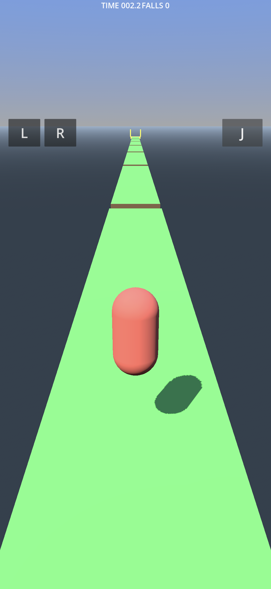

# 001 · Voxel Parkour

A tiny Minecraft-style parkour auto-runner for Android, built with **Godot 4** —
coded end-to-end by an AI agent under human direction, from empty folder to
on-device verified APK.



## Download & play

Grab the APK from [**Releases**](https://github.com/cykgames/001-parkour/releases)
and install on any arm64 Android phone.

- **TAP TO START** — the character auto-runs forward.
- **Left half of screen**: floating joystick. Touch anywhere, drag left/right to
  strafe (analog — further drag = faster). Releases re-center automatically.
- **J button**: jump.
- Collect coins, dodge stone blocks, jump the gaps. Falling respawns you at the
  last checkpoint. Reach the gold gate to clear the level.
- 3 levels: **GRASSLAND → CANYON → FROST** (narrower path, moving platforms,
  wider gaps).

## Build from source

Requirements: [Godot 4.7.2](https://godotengine.org/download) (standard build) +
matching export templates. For APK export, configure Android SDK + JDK 17 in
Godot editor settings.

```bash
# headless self-test: auto-plays all 3 levels, prints FINAL x3 + ALL_LEVELS_DONE
godot --headless --path .

# export debug APK
godot --headless --path . --export-debug "Android" build/godot-parkour.apk
```

**No external assets.** Voxel terrain is procedural (ArrayMesh), all SFX/BGM are
synthesized by `tools/gen_audio.py`, the icon by `tools/gen_icon.py`.

## Repo layout

- `*.gd` / `Main.tscn` — game code: level gen, player controller (coyote time +
  jump buffer), camera rig, HUD, floating joystick
- `audio/` — generated wav SFX + chiptune BGM
- `tools/` — headless regression scenes + adb tap-driver (`w7_play.py`; set
  `PARKOUR_ADB_SERIAL` env to your device)
- `docs/` — development checkpoints W1→W7 (the agent's dev log)

## How it was built

- **W1–W3** MVP: procedural course, auto-run controller, headless autopilot
  that clears the level with zero falls
- **W5+W6** game feel: smooth camera + trauma shake, SFX/BGM, particles, coins,
  checkpoints, restart flow
- **W7** on-device verification over ADB: caught and fixed a checkpoint-respawn
  bug, verified the full loop on real phones

Every wave was verified on real hardware before moving on. Full log in `docs/`.

---

Part of the [**cykgames**](https://github.com/cykgames) catalog — small games,
one numbered repo per title.
